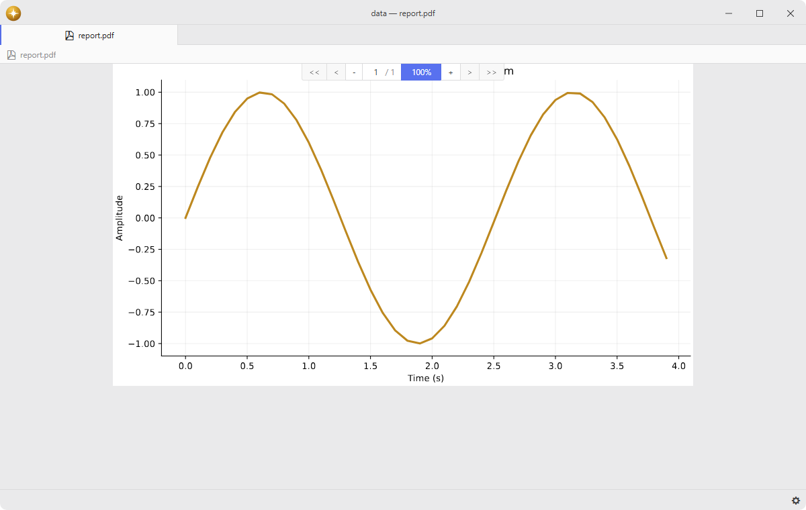

# pdf-view

View PDF files directly in the editor.

The Metadata panel reads page counts, document information and available XMP fields from the loaded PDF, refreshing when the document reloads.

Built on Mozilla's PDF.js with native controls, document search and outline navigation.

## Features

- **Native controls**: compact viewing controls follow the active theme, with smooth panning and a themed preview background.
- **Zoom**: fits width up to 100%, offers preset levels in the zoom value's context menu and animates zoom changes smoothly.
- **PDF.js components**: renders selectable text, links and existing annotations without an iframe or the generic viewer application.
- **Navigation**: supplies bookmarks and current-section information to the navigation panel.
- **Search**: supplies read-only document search to the search panel.
- **Scrollmap**: shows outline headings and matching pages through the shared overview widget, with only top-level headings shown by default.
- **SyncTeX**: opens the corresponding source position from the context menu when a LaTeX service is available.
- **Auto-reload**: watches the file on disk, preserves the current view when refreshing and pauses reloads during LaTeX or Typst builds.
- **Large documents**: reads disk ranges on demand, limits page canvases and leaves page rendering to PDF.js's rendering queue.



## Installation

To install `pdf-view` search for it in the Install pane of the Lumine settings, or run the command `lumine --install lumine-code/pdf-view`.

## Commands

Commands available in `.pdf-view`:

- `pdf-view:previous-page`: go to the previous page,
- `pdf-view:next-page`: go to the next page,
- `pdf-view:first-page`: go to the first page,
- `pdf-view:last-page`: go to the last page,
- `pdf-view:zoom-in`: zoom in smoothly,
- `pdf-view:zoom-out`: zoom out smoothly,
- `pdf-view:zoom-next-level`: increase zoom to the next preset level,
- `pdf-view:zoom-previous-level`: decrease zoom to the previous preset level,
- `pdf-view:automatic-zoom`: fit the page width up to 100%,
- `pdf-view:fit-width`: fit the page width to the viewer,
- `pdf-view:fit-to-view`: fit the whole page in the viewer,
- `pdf-view:zoom-100`: show the page at 100%,
- `pdf-view:rotate-clockwise`: rotate clockwise,
- `pdf-view:rotate-counterclockwise`: rotate counterclockwise,
- `pdf-view:select-tool`: enable text selection,
- `pdf-view:hand-tool`: enable dragging to pan,
- `pdf-view:scroll-up`: scroll up smoothly,
- `pdf-view:scroll-down`: scroll down smoothly,
- `pdf-view:scroll-left`: scroll left smoothly,
- `pdf-view:scroll-right`: scroll right smoothly,
- `pdf-view:page-up`: scroll up by one viewport,
- `pdf-view:page-down`: scroll down by one viewport,
- `pdf-view:refresh`: reload the PDF and preserve the current view,
- `pdf-view:copy`: copy selected text,
- `pdf-view:synctex`: open the source at the clicked PDF position.

## Usage

PDF panes and split copies work within the current native window. Moving a PDF pane between native windows is not supported.

Opening another PDF in a pending preview reuses its pane item and native controls. The replacement is prepared before the displayed document changes; keeping the tab, closing it or starting another opening cancels an unfinished replacement.

## Customization

Adjust the viewer background in your stylesheet:

```css
.pdf-view .pdf-view-container {
  background-color: var(--pane-item-background-color);
}
```

## Services

- [`pdf-view`](docs/pdf-view.md): provided to open PDF panes and navigate their documents.
- `navigation.adapter`: provided to expose bookmarks through the navigation panel.
- `search.adapter`: provided to search the PDF through the search panel.
- `invert-colors.provider`: provided to invert document pages without changing the controls.
- `scrollmap.widget`: consumed to draw document and search markers beside the native scrollbar.
- `latex-tools`: consumed for SyncTeX and build coordination.
- `typst-tools`: consumed for build coordination.
- `background-tips.provider`: provided to describe PDF viewing in the empty workspace.

## Development

Run `npm install --ignore-scripts` inside this directory. Tests live in `spec/`: run `node scripts/test.js` for the isolated Lumine integration specs and `npm run test:unit` for the Node unit tests in `spec/unit/`. The test launcher uses the sibling editor source or `LUMINE_RESOURCE_PATH` and an isolated profile.

Run `node scripts/preview.js "C:/path/to/document.pdf"` to open an isolated preview with the local navigation, search and build-service packages. The preview uses `.dev/preview-home` and does not change the normal development profile.

## Performance

Set `PDF_VIEW_BENCH_FILE` to the absolute path of a local PDF and run `node scripts/test.js spec/performance-spec.js`. `PDF_VIEW_BENCH_OUTPUT` optionally selects the JSON report path; the default is `.dev/performance.json`. Reports contain timings, byte counts, page counts and memory usage without the document path, contents or query. The supplied test document stays outside this repository.

## Contributing

Got ideas to make this package better, found a bug, or want to help add new features? Just drop your thoughts on GitHub. Any feedback is welcome!
